<h1 align="center">Little Note - Kotlin</h1>

<p align="center">
 <a></a>
 <a></a>
 <a href="https://kotlinlang.org"></a>
 <a href="https://opensource.org/licenses/MIT"></a>
</p>

<p align="center">
  <strong>Little Note</strong> is a highly secure, feature-rich Android application designed for streamlined personal note management. Built with modern Kotlin standards, it offers seamless cloud synchronization, biometric protection, and an intuitive user interface.
</p>

---

## 📱 Screenshots

### Day Mode
Splash | Save Note | Login 
--- | --- | --- | 
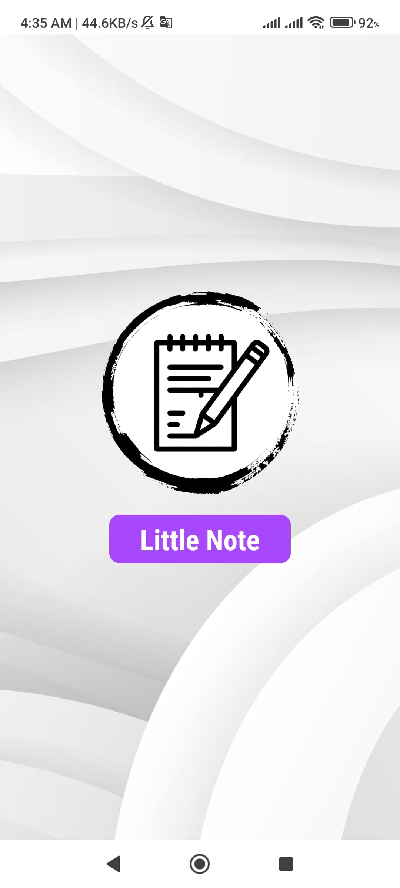 | 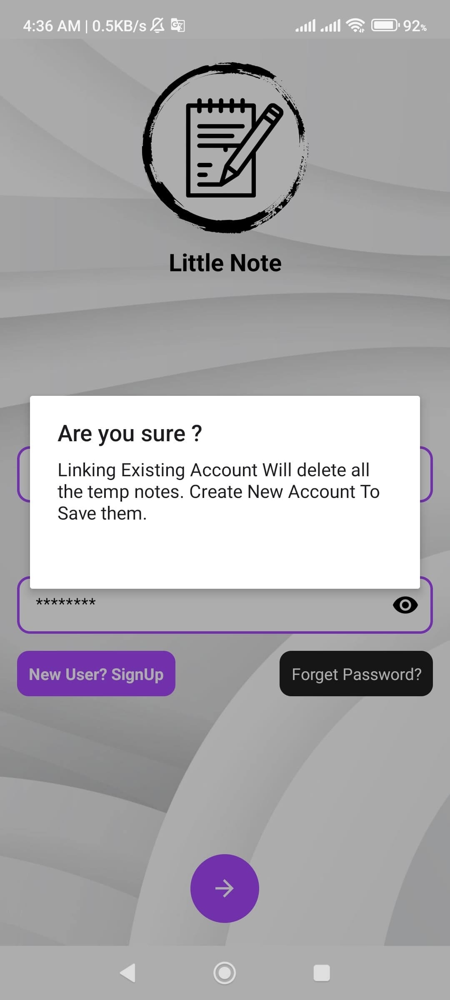 | 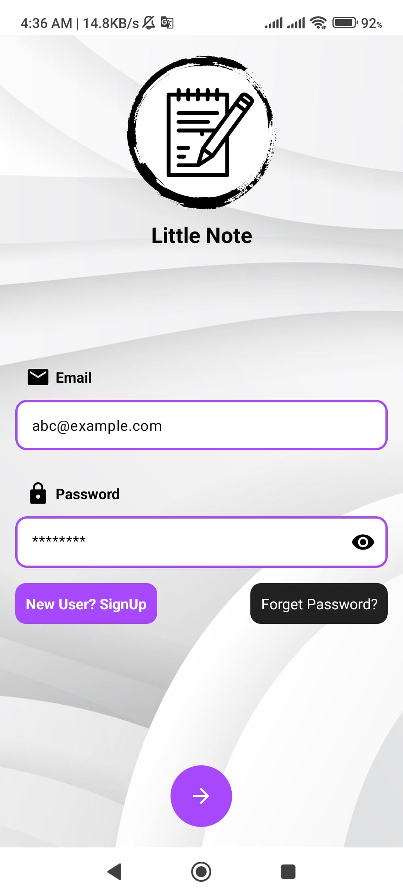 | 

Register | Forget Pass | My Notes
--- | --- | --- | 
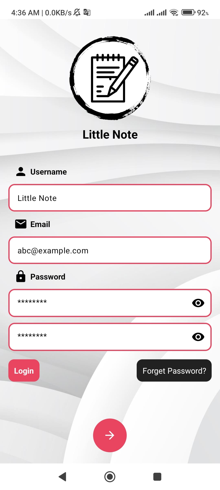 | 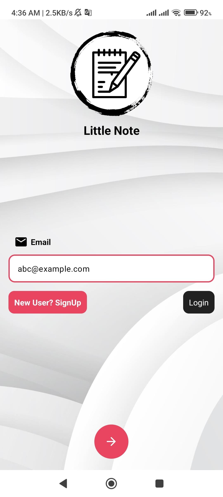 | 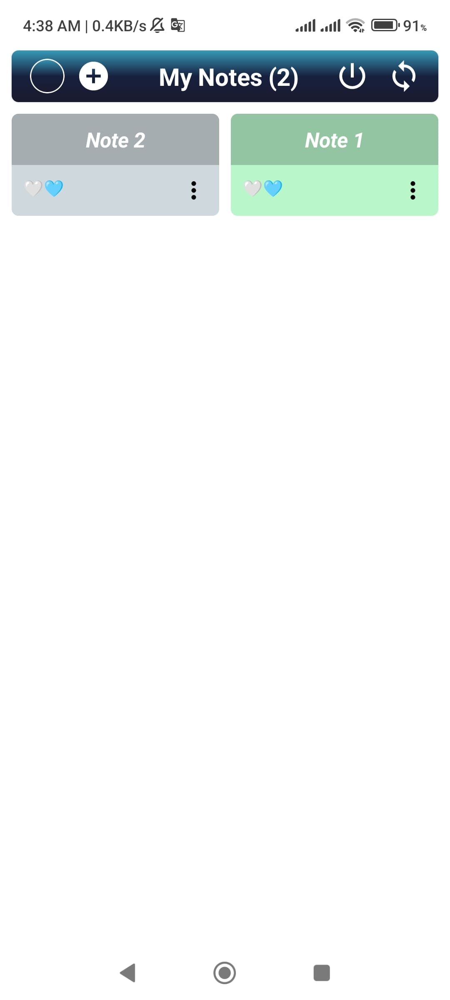 | 

Add/Edit Note | Details | Login Note 
--- | --- | --- | 
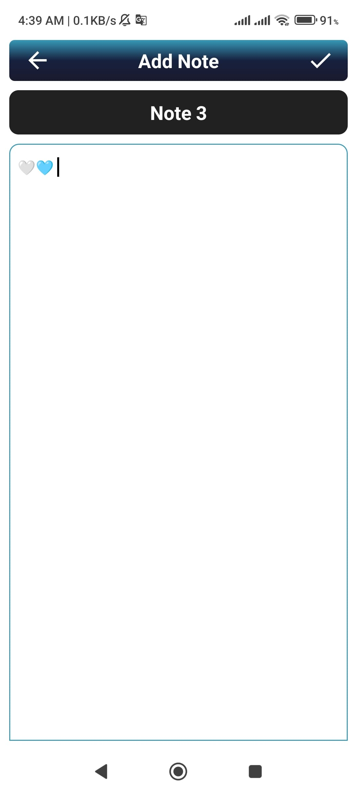 | 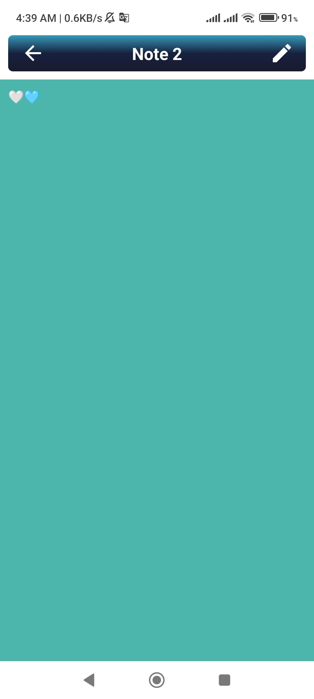 | 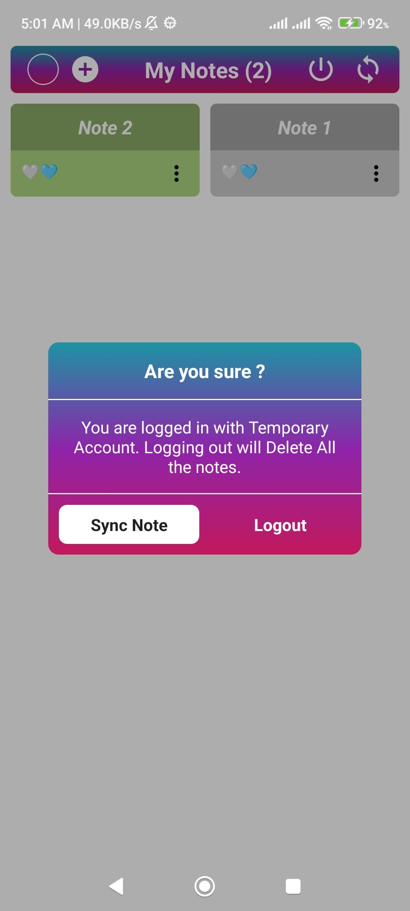 | 

## Night Mode
Splash | Save Note | Login 
--- | --- | --- | 
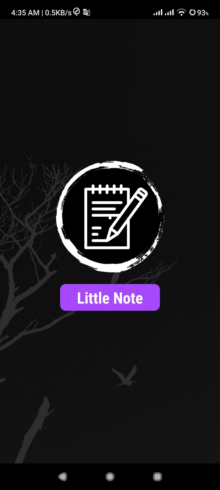 | 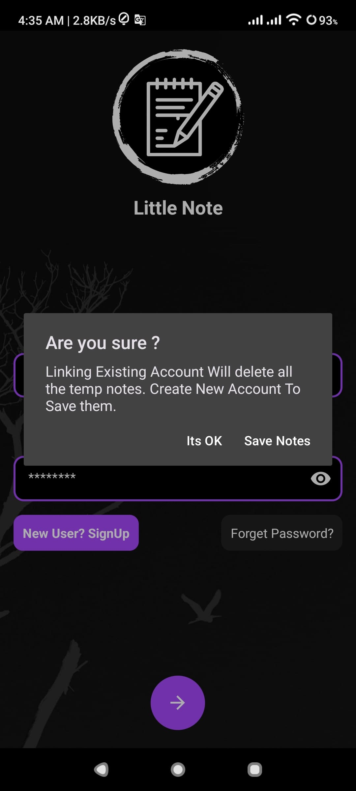 | 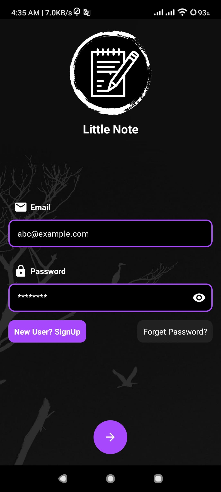 | 

Register | Forget Pass | My Notes
--- | --- | --- | 
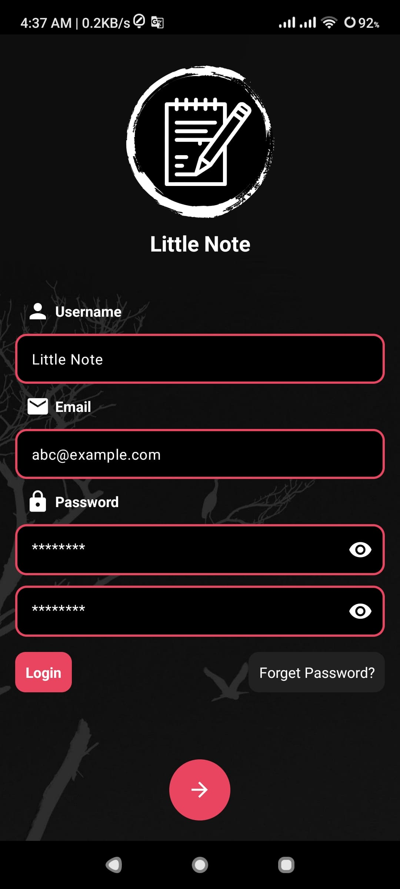 | 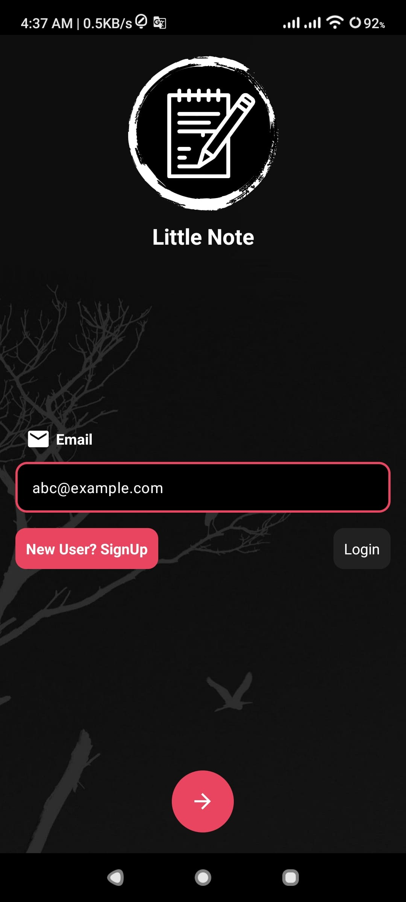 | 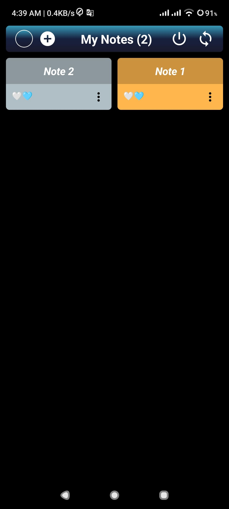 | 

Add/Edit Note | Details | Login Note 
--- | --- | --- | 
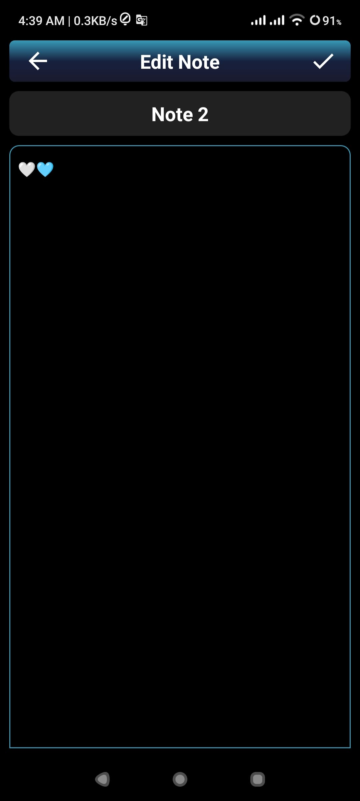 | 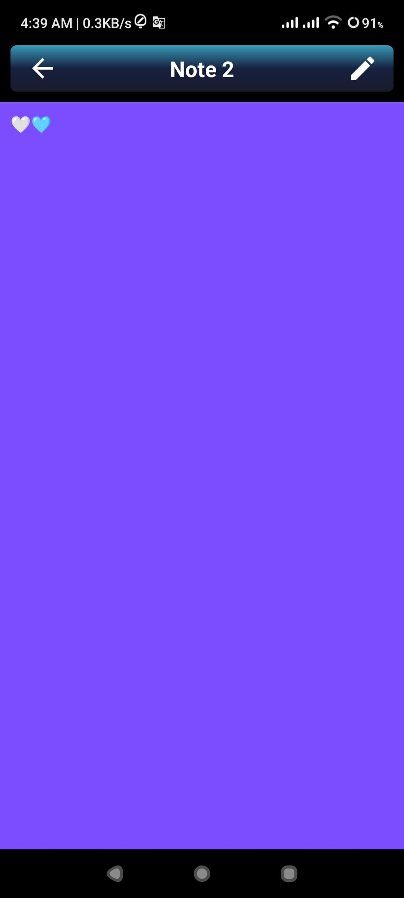 | 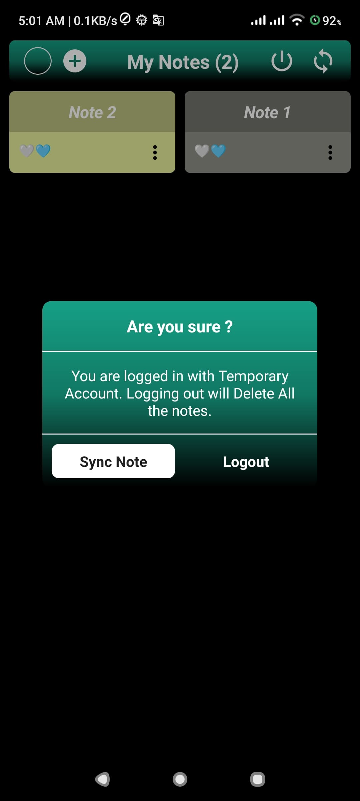 | 

---

### ✨ Core Functionalities
*   **Robust Authentication Flow**: Secure identity management via **Firebase Authentication**.
*   **Dynamic Note Orchestration**: Full CRUD operations for managing personal records through a refined interface.
*   **Granular Privacy Controls**: Secure sensitive content using specialized **Private Note** lockers.
*   **Advanced Biometric Integration**: Rapid user access leveraging native hardware security.
*   **Elastic Cloud Synchronization**: Distributed data persistence via **Firebase Firestore**.
*   **Context-Aware Theming**: Adaptive UI support for dark and light modes.
*   **Resilient Offline Capabilities**: "Local-first" data strategy using **Room Database**.
*   **Intelligent Background Operations**: Decoupled task execution managed by **WorkManager**.

---

## 🛠️ Built With
*   **Language:** [Kotlin](https://kotlinlang.org/)
*   **UI Framework:** Material Design 3, ViewBinding
*   **Database:** [Room](https://developer.android.com/training/data-storage/room)
*   **Cloud Infrastructure:** [Firebase](https://firebase.google.com/) (Auth, Firestore)
*   **Dependency Injection:** [Hilt](https://developer.android.com/training/dependency-injection/hilt-android)
*   **Navigation:** [Jetpack Navigation](https://developer.android.com/guide/navigation)
*   **Async Operations:** Coroutines & Flow
*   **Logging:** [Timber](https://github.com/JakeWharton/timber)
*   **Background Tasks:** [WorkManager](https://developer.android.com/topic/libraries/architecture/workmanager)

---

### 🏗️ Technical Architecture
The application is engineered using **MVVM (Model-View-ViewModel)** architectural patterns, strictly adhering to **Clean Architecture** principles to promote modularity and ease of maintenance.

```text
app/src/main/java/com/flatcode/littlenote/
├── di/                 # Dependency Injection (Hilt modules)
├── ui/                 # Presentation Layer
│   ├── auth/           # Authentication (Login, Register, Forget Password)
│   ├── home/           # Dashboard and Navigation
│   ├── note/           # Note Operations (Add, Edit, View, Details)
│   ├── splash/         # App Entry Point
│   └── adapter/        # RecyclerView Adapters
├── viewmodel/          # Logic Layer (State Management & UI Logic)
├── data/               # Data Layer (Local & Remote)
│   ├── dao/            # Room Database DAOs
│   ├── model/          # Data Entities & Models
│   ├── repository/     # Repository Pattern Implementation
│   ├── database/       # Room Database Configuration
│   └── sync/           # Firebase Sync Logic
├── functions/          # Specialized Workflows (AppFunctions)
└── utils/              # Extensions, Constants & Utility Classes
```

---

## 🚀 Getting Started

### Prerequisites
*   Android Studio Ladybug or newer.
*   JDK 21.
*   Android SDK Level 37 (Compile SDK).

### Installation
1.  Clone the repository:
    ```bash
    git clone https://github.com/selimdawa/LittleNoteKotlin.git
    ```
2.  Open the project in Android Studio.
3.  Sync Project with Gradle Files.
4.  Add your `google-services.json` file to the `app/` directory.
5.  Run the app on your device or emulator.

---

### 🛠️ Technology Stack
*   **Language**: Kotlin (Modern, expressive, and safe development).
*   **Dependency Injection**: **Dagger Hilt** (Simplified, standard DI for Android).
*   **Cloud Infrastructure**: **Firebase** (Scalable authentication and real-time NoSQL storage).
*   **Local Persistence**: **Room** (SQLite abstraction layer for robust offline data).
*   **Navigation**: **Jetpack Navigation** (Type-safe and standardized screen transitions).
*   **Concurrency**: **Coroutines & Flow** (High-performance asynchronous data streams).
*   **View Interop**: **ViewBinding** (Safe and efficient UI component interaction).
*   **Observability**: **Timber** (Extensible logging for enhanced diagnostic capabilities).
*   **Background Tasks**: **WorkManager** (Reliable execution of deferred operations).
*   **Security**: **Biometric API** (Native hardware-backed authentication).

---

## 🔗 Links & Resources
*   **Compose Version:** [Little Note Compose](https://github.com/selimdawa/LittleNoteCompose/)
*   **Legacy Versions:**
    *   [Kotlin Old Code Version](https://github.com/selimdawa/LittleNoteKotlinOld/)
    *   [Java Old Code Version](https://github.com/selimdawa/LittleNote/)
*   **Author:** [Selim Dawa](https://github.com/selimdawa)

---

## 📜 License
This project is licensed under the MIT License - see the [LICENSE](LICENSE) file for details.
